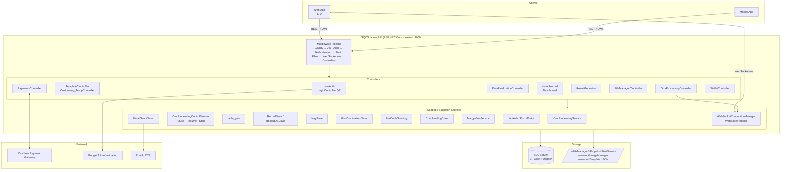
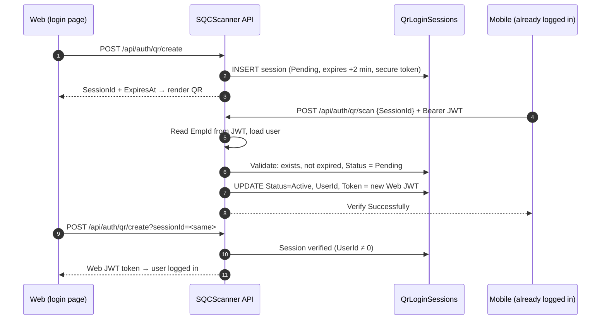
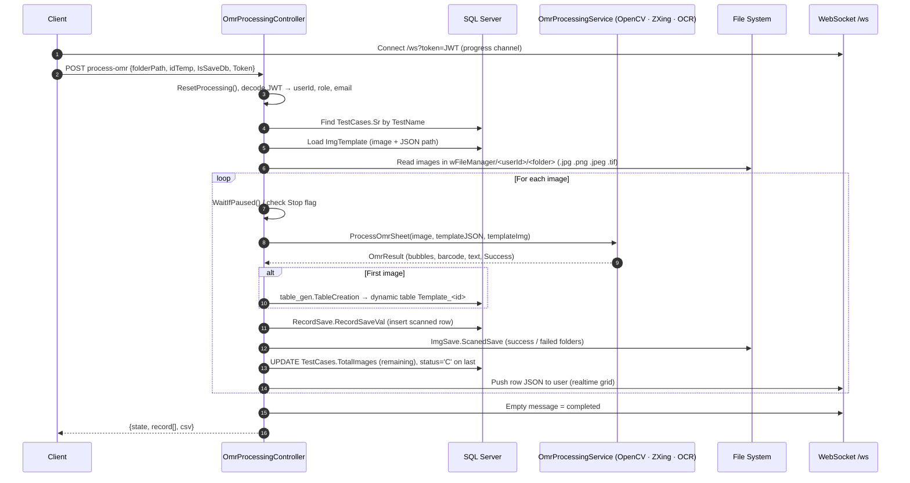
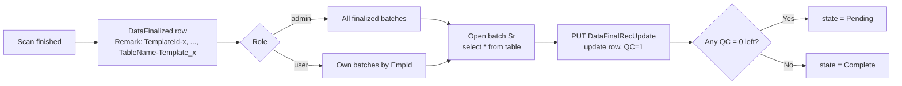
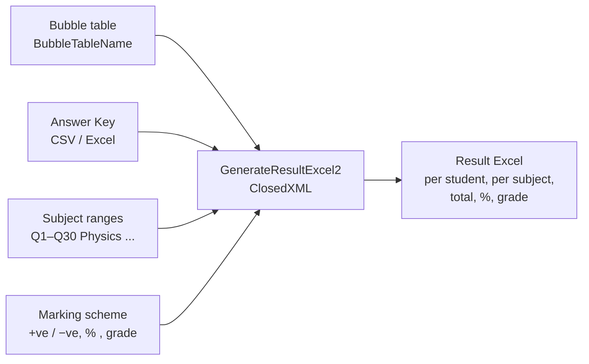
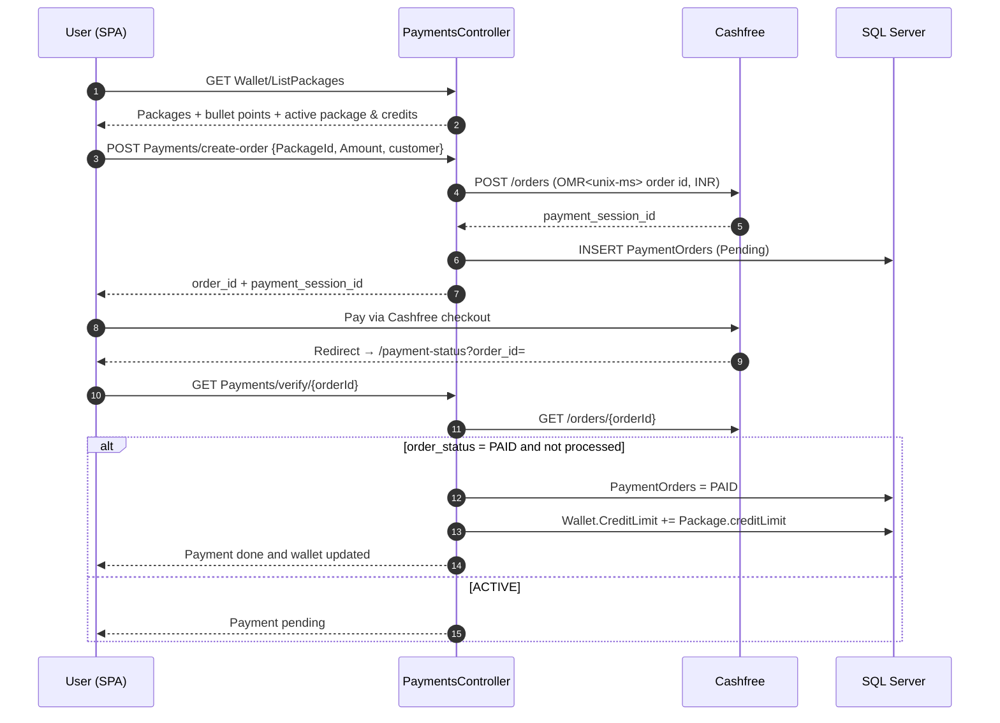
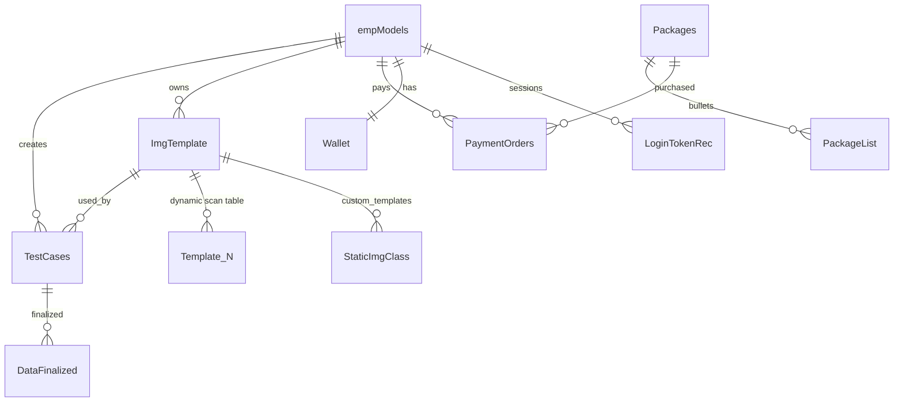
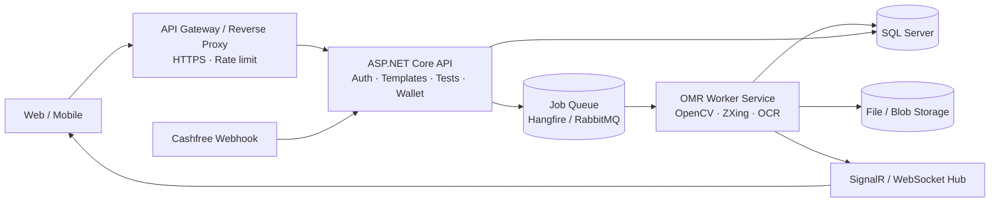

# SQCScanner — OMR Image-Based Backend
### API Workflow · System Design · End-to-End Architecture

> **Aditya Infotech, Agra** — *Creative Business Growth*
> Presentation document for the `SQCScanner` ASP.NET Core backend (OMR sheet scanning, result generation, wallet & payments).

---

## 1. Project Overview

**SQCScanner** ek OMR (Optical Mark Recognition) processing platform hai. User apni OMR sheet ke images upload karta hai, system template ke basis par bubbles / barcode / characters read karta hai, data SQL Server mein save karta hai, realtime progress WebSocket se bhejta hai, QC (data finalization) karwata hai aur end mein Excel result generate karta hai. Usage **credit-based** hai — packages Cashfree payment se kharide jaate hain.

| Item | Detail |
|---|---|
| Backend | ASP.NET Core Web API (C#), Kestrel on port **9900** |
| Database | SQL Server (connection key `dbc`) via **EF Core** + **Dapper** |
| Auth | JWT Bearer, QR-based web login, Google token login, OTP email |
| Image / OMR | OpenCvSharp, ZXing (barcode), TesseractOCR |
| Reports | ClosedXML (Excel), DocumentFormat.OpenXml, Syncfusion (licensed) |
| Files | Syncfusion FileManager `PhysicalFileProvider`, static folders `wFileManager`, `wwwroot` |
| Realtime | Native WebSocket endpoint `/ws?token=<JWT>` |
| Payments | Cashfree PG (create-order / verify) |
| Logging | Serilog (config driven), Sentry reference, Swagger UI at `/swagger` |
| Clients | Web app (Angular/React style SPA), Mobile app (`*Mob` endpoints) |

---

## 2. End-to-End Architecture



### 2.1 Layered view

| Layer | Responsibility | Examples |
|---|---|---|
| **Presentation** | REST controllers, Swagger, static file hosting | `*Controller.cs`, `showRecord.cs`, `userAuth.cs` |
| **Application / Services** | OMR scanning, table generation, saving, image archive, email, JWT, WebSocket | `OmrProcessingService`, `table_gen`, `RecordSave`, `ImgSave` |
| **Data access** | EF Core `ApplicationDbContext` (users, templates, finalized data) + Dapper raw SQL (tests, wallet, payments, dynamic tables) | `Version1.Data` |
| **Infrastructure** | SQL Server, local disk, Cashfree, SMTP, WebSocket | — |

### 2.2 Request pipeline (`Program.cs`)

1. Serilog + EF Core `DbContext` + DI registration
2. Kestrel `ListenAnyIP(9900)`, body limit **3 GB** (large image batches / ZIP upload)
3. CORS policy `AllowAnyOrigin`
4. `UseAuthentication` → `UseAuthorization` → `MapControllers`
5. Swagger + SwaggerUI
6. Static files: `/wFileManager`, `/wwwroot` (with `Access-Control-Allow-Origin: *`)
7. WebSocket middleware at `/ws` — token read from query string, `userId` taken from JWT claim `nameid`, one socket per user (reconnect replaces old socket)

---

## 3. Core Business Workflow (Customer Journey)

```mermaid
flowchart LR
    A[1. Sign Up / Login] --> B[2. Buy Package<br/>Cashfree]
    B --> C[3. Wallet Credits Added]
    C --> D[4. Create OMR Template<br/>image + coordinates JSON]
    D --> E[5. Create Test<br/>folder per user/test]
    E --> F[6. Upload Scanned Images<br/>files / ZIP]
    F --> G[7. Process OMR<br/>realtime via WebSocket]
    G --> H[8. Data Finalization / QC<br/>edit wrong records]
    H --> I[9. Generate Result Excel<br/>answer key + marking scheme]
    I --> J[10. Dashboard & Reports]
```



---

## 4. Detailed API Workflows

### 4.1 Authentication & Session

**Controllers:** `userAuth` (`api/userAuth`), `LoginController` (`api/auth/qr`)

| Method | Endpoint | Purpose |
|---|---|---|
| POST | `/api/userAuth/SignUp` | Web sign-up (name, email, pwd, contact, role, referenceId) + OTP |
| POST | `/api/userAuth/SignUpMob` | Mobile sign-up |
| POST | `/api/userAuth/Verify` | Verify email OTP → JWT |
| POST | `/api/userAuth/LoginForm` | Email + password login → JWT, `LoginTokenRec` updated |
| POST | `/api/userAuth/GoogleToken` | Google sign-in |
| POST | `/api/userAuth/ForgetRequest` | Send OTP for password reset |
| GET | `/api/userAuth/RefreshToken` | Issue fresh JWT |
| GET | `/api/userAuth/DeviceLogOut` | Logout from all devices |
| POST | `/api/userAuth/GetList` | Paged / searchable employee list (admin) |
| PUT | `/api/userAuth/Update` | Update user |
| DELETE | `/api/userAuth/DeleteEmp` | Delete user |
| POST | `/api/userAuth/updateProfiles` | Profile + image update (multipart) |

#### QR Login (Web ⇄ Mobile)



**JWT claims used across system:** `nameid` (EmpId), `unique_name`, `email`, `role` (`admin` / user).

---

### 4.2 Template Management

**Controllers:** `TemplateController`, `CustomImg_TempController`

An OMR **template** = blank sheet image + JSON with bubble / barcode / field coordinates.

| Method | Endpoint | Purpose |
|---|---|---|
| POST | `/api/Template/Create_ImeTemp` | Upload template image (jpg/jpeg/png), unique template name check, save to `wwwroot/ImageManager`, row in `ImgTemplate` |
| GET | `/api/Template/Single_ImeTem?id=` | Single template |
| GET | `/api/Template/List_ImeTemp` | Templates (admin: all, user: own via `EmpiId`) |
| PUT | `/api/Template/Update_ImeTemp` | Replace template image |
| DELETE | `/api/Template/Del_ImeTemp?id=` | Delete template + files |
| POST | `/api/OmrProcessing/findCrodination` | Test image + JSON structure → coordinate detection (`FindCordinationClass`) |
| POST | `/api/CustomImg_Temp/CreateImgTemplate` | Static image template (base64 in `StaticImgClass`) |
| PUT/GET/DELETE | `/api/CustomImg_Temp/UpdateImgTemplate · ViewImgTempale · DeleteImgTempale` | Static template CRUD |
| POST/GET/PUT/DELETE | `/api/CustomImg_Temp/createimgtempDes · getimgtempDes · UpdateImgtempDes · DeleteimgtempDes` | Template **design** (layout) CRUD |

---

### 4.3 Test (Batch) Management & Image Upload

A **Test** = one scanning batch for one user. Creates folder `wFileManager/<EmpId>/<TestName>` and row in `TestCases` (`TemplateId, TestName, TestId, Notes, status, EmpId, TotalImages, QuestionRange`).

| Method | Endpoint | Purpose |
|---|---|---|
| POST | `/api/Template/CreateTest` · `CreateTestMob` | Create test (web / mobile) |
| POST | `/api/Template/GetTest` · `GetTestEmp` | Paged test list (all / per employee) |
| PUT | `/api/Template/UpdateTest` | Update test |
| DELETE | `/api/Template/DeleteTest?testId=` | Delete test |
| POST | `/api/Template/uploadImage` · `UploadImageMob` | Upload multiple images into test folder (safe short filenames, extension validation, per-image size limit), **WebSocket progress** |
| POST | `/api/Template/upload` | Upload **archive / ZIP** of images, extract, WebSocket progress |

---

### 4.4 OMR Processing (Core Engine)

**Controller:** `OmrProcessingController` — `POST /api/OmrProcessing/process-omr`



**Processing controls**

| Method | Endpoint | Effect |
|---|---|---|
| POST | `/api/OmrProcessing/pause-processing` | Pause loop (`WaitIfPaused`) |
| POST | `/api/OmrProcessing/resume-processing` | Resume |
| POST | `/api/OmrProcessing/stop-processing` | Stop + break loop. Also auto-stopped when the user's WebSocket disconnects |

**Helper endpoints**

| Method | Endpoint | Purpose |
|---|---|---|
| POST | `/api/OmrProcessing/GetCSVHeader` · `GetCSVHeaderMob` | Read CSV headers (for result / merge mapping) |
| GET | `/api/OmrProcessing/DataResponce?templateId&PageNo&PageSize` | Paged scanned data for a template |

---

### 4.5 Data Finalization (QC / Review)

**Controller:** `DataFinalizationController`

Scanned data is reviewed; wrong / unreadable records are corrected, a `QC` flag set per row, and overall state becomes **Pending → Complete**.



| Method | Endpoint | Purpose |
|---|---|---|
| GET | `/api/DataFinalization/DataFinalGetList?Sr=` | `Sr=0` list of finalized batches (admin gets template JSON path too); `Sr>0` returns the actual table records + table name |
| PUT | `/api/DataFinalization/DataFinalRecUpdate` | Update one record in dynamic table, mark `QC = 1`, refresh batch state & IST timestamp |

---

### 4.6 Records & Dashboard

**Controller:** `showRecord` (`[Authorize]`)

| Method | Endpoint | Purpose |
|---|---|---|
| GET | `/api/showRecord/getRec` | Window of 200 records around an Id from `Template_<id>` |
| GET | `/api/showRecord/LastRec` | Last 100 records of user for a template |
| GET | `/api/showRecord/Dash_AllRec` · `Dash_OptimizedAllRec` | Total scanned count across all template tables |
| GET | `/api/showRecord/Dash_ReadyTemp` | Number of templates ready |
| GET | `/api/showRecord/Dash_Avrage` | Success vs failed (Status True/False) |
| GET | `/api/showRecord/6_MonthRec` · `monthSplit` | Month-wise scan trend (success / failed) |
| GET | `/api/showRecord/GetDB_Rec?fileName=` | List / open a user's scanned tables |
| DELETE | `/api/showRecord/AllRecDel` | Delete all records + images of a folder / template |
| DELETE | `/api/showRecord/Delete_Rec?deleteName=` | Delete a scanned table |

---

### 4.7 Result Generation & Reporting

**Controller:** `ResultGenration` (`[Authorize]`)



| Method | Endpoint | Purpose |
|---|---|---|
| POST | `/api/ResultGenration/GenerateResultExcel2` | Compare scanned answers with answer key, subject-wise scoring, extra columns, percentage, grade → Excel |
| POST | `/api/ResultGenration/MargeCSV` | Merge two CSVs on a common key (ignore columns / filter key) |
| GET | `/api/ResultGenration/export-db` | Database backup (`.bak`) |
| POST | `/api/ResultGenration/import-db` | Restore from uploaded file |

---

### 4.8 File Manager

**Controller:** `FileManagerController` (Syncfusion `PhysicalFileProvider`)

| Method | Endpoint | Purpose |
|---|---|---|
| GET/POST | `/api/FileManager/folders` | List / create folder |
| POST | `/api/FileManager/FileOperations` | Read, create, rename, delete, copy, move, search, details |
| POST | `/api/FileManager/Upload` · `Download` | Upload / download files |
| GET | `/api/FileManager/GetImage` | Image preview |
| GET/POST | `/foldersM` · `FileOperationsM` · `UploadM` · `DownloadM` · `GetImageM` | Mobile / user-scoped variants |
| POST | `/api/FileManager/UploadDeleteView` | Upload with delete-view flow |

---

### 4.9 Packages, Wallet & Payments

**Controllers:** `WalletController` (`[Authorize]`), `PaymentsController`



| Method | Endpoint | Purpose |
|---|---|---|
| POST | `/api/Wallet/AddPackage` | Create package + bullet points (transactional, PackId = max+1, starts 1001) |
| DELETE | `/api/Wallet/DeletePackage?PackId=` | Delete package + list |
| GET | `/api/Wallet/ListPackages` | All packages + current active package & credits |
| POST | `/api/Wallet/RechargeWallet` | Manual transaction + wallet credit |
| GET | `/api/Wallet/GetWalletTran` · `GetWallet` · `PaymentHistory` | Transactions / wallet / payment history |
| POST | `/api/Payments/create-order` | Create Cashfree order |
| GET | `/api/Payments/verify/{orderId}` | Verify & credit wallet |

---

## 5. Realtime Channel (WebSocket)

| Item | Detail |
|---|---|
| URL | `ws(s)://<host>:9900/ws?token=<JWT>` |
| Identity | `nameid` claim → one live socket per user (old socket removed on refresh / new tab) |
| Server → Client | OMR row JSON per scanned image, upload progress, empty message = finished |
| Client → Server | Control messages handled by `WebSoketHandler.HandleControlMessage` |
| On disconnect | `OmrProcessingControlService.StopProcessing()` + socket cleanup |

---

## 6. Data Model (from code)



| Table | Purpose |
|---|---|
| `empModels` | Users (EmpId, name, email, password, contact, role, OTP, reference id) |
| `LoginTokenRec` | Active token, expiry, role, `isLoggedIn` per user |
| `QrLoginSessions` | QR login sessions (SessionId, Status, UserId, Token, CreatedAt, ExpiresAt) |
| `ImgTemplate` | Template (name, image path, JSON path, description, EmpiId) |
| `StaticImgClass` | Static/custom image templates (base64) |
| `TestCases` | Test batches (TemplateId, TestName, TestId, status, TotalImages, QuestionRange) |
| `Template_<id>` / `Tem_<userId>_*` | **Dynamic tables** created at first scan — one per template/test; columns from template JSON + `Status`, `LiveTime`, `QC` |
| `DataFinalized` | QC batch (Sr, EmpId, TestId, Remark with TemplateId & TableName, state, Time) |
| `Packages`, `PackageList` | Pricing plans + bullet points |
| `PaymentOrders` | Cashfree orders (OrderId, SessionId, EmpId, PackageId, Amount, status) |
| `Wallet` | Credit balance per user |
| `Transaction` | Manual wallet transactions |

---

## 7. Storage Layout

```
<app root>/
├── wFileManager/                  # user data (static, CORS open)
│   └── <EmpId>/<TestName>/        # uploaded OMR images
│       └── scanned success / failed folders (ImgSave)
├── wwwroot/
│   ├── ImageManager/              # template images
│   └── <template JSON paths>      # coordinate definitions
├── backup.bak                     # export-db output
└── appsettings.json               # ConnectionStrings:dbc, Cashfree:*, Serilog, JWT
```

---

## 8. Security & Quality Review (Recommended Before Production)

Code review ke dauran jo points mile — presentation mein "Roadmap / Hardening" slide ke liye.

| # | Area | Observation | Recommendation |
|---|---|---|---|
| 1 | **SQL Injection** | Many queries use string interpolation (`Wallet`, `DataFinalization`, `TestCases`, `showRecord`, `userAuth`, `Payments`) | Use Dapper parameters (`@param`) everywhere; whitelist/validate dynamic table names |
| 2 | **Passwords** | Compared & stored as plain text (`password != pwd`) | Hash with BCrypt / Argon2 / ASP.NET Identity hasher; send credentials in body, not query string |
| 3 | **JWT handling** | Tokens read with `ReadJwtToken` (no signature check) in several actions; `process-omr` is `[AllowAnonymous]` and trusts the token in the body | Use `[Authorize]` + `User.Claims`; never decode unvalidated tokens |
| 4 | **Authorization** | Several controllers have no `[Authorize]` (`userAuth`, `Payments`, `DataFinalization`); admin-only actions (AddPackage, DeletePackage, export/import DB) lack role checks | Add `[Authorize(Roles="admin")]` where needed |
| 5 | **Secrets** | Syncfusion license key hard-coded in `Program.cs`; Cashfree keys in config | Move to environment variables / Azure Key Vault / user-secrets; rotate the exposed license key |
| 6 | **CORS** | `AllowAnyOrigin` | Restrict to known front-end domains |
| 7 | **Payment integrity** | Wallet credit happens in verify call (client-triggered); return URL hard-coded to `localhost:3000`; wallet math not in a transaction | Add Cashfree **webhook** with signature check, idempotency, DB transaction |
| 8 | **Wallet / credits** | Credits not yet visibly deducted per scan in processing loop | Deduct per recognized sheet inside a transaction |
| 9 | **Large uploads** | 3 GB body limit & very large per-file limits | Lower limits, stream to disk, add virus / type checks |
| 10 | **Reliability** | Long synchronous-style scanning inside one HTTP request; global singleton `OmrProcessingControlService` (shared pause/stop across all users) | Move to background queue (Hangfire / `BackgroundService` / Channels), per-user job state |
| 11 | **Duplicate code** | `*M` / `Mob` endpoint variants, duplicate `ResultRequest` classes, duplicate `app.MapControllers()` and `AddHttpClient()` | Refactor into shared services |
| 12 | **Error contract** | Mix of `Ok(false)`, `NotFound`, `BadRequest` and `status/state` flags | Standard `ProblemDetails` / one response envelope |
| 13 | **Observability** | `Console.WriteLine` used widely | Serilog structured logs only, correlation id |

---

## 9. Recommended Target Architecture (Next Phase)



Benefits: scalable OMR workers, per-user job control, safer payments, restartable processing, centralized secrets.

---

## 10. API Summary Matrix

| Module | Controller | Base route | Auth |
|---|---|---|---|
| Auth | `userAuth` | `api/userAuth` | Public + token-based actions |
| QR Login | `LoginController` | `api/auth/qr` | `create` public, `scan` `[Authorize]` |
| Templates & Tests | `TemplateController` | `api/Template` | `[Authorize]` |
| Custom Templates | `CustomImg_TempController` | `api/CustomImg_Temp` | `[Authorize]` |
| OMR Engine | `OmrProcessingController` | `api/OmrProcessing` | `process-omr` anonymous (token in body) |
| Data QC | `DataFinalizationController` | `api/DataFinalization` | Token read manually |
| Dashboard | `showRecord` | `api/showRecord` | `[Authorize]` |
| Results | `ResultGenration` | `api/ResultGenration` | `[Authorize]` |
| Files | `FileManagerController` | `api/FileManager` | — |
| Wallet | `WalletController` | `api/Wallet` | `[Authorize]` |
| Payments | `PaymentsController` | `api/Payments` | Token read manually |

---

## 11. One-Slide Summary (for Presentation)

> **Upload → Template → Scan → Review → Result → Pay-per-use**
> A credit-based OMR platform: JWT/QR secured, OpenCV-powered recognition, realtime WebSocket progress, SQL Server dynamic tables per template, Excel result engine, and Cashfree wallet billing.

---
*Prepared for Aditya Infotech · Generated from the uploaded backend source (Program.cs and 11 controllers). Items marked as recommendations are review suggestions, not current behaviour.*
